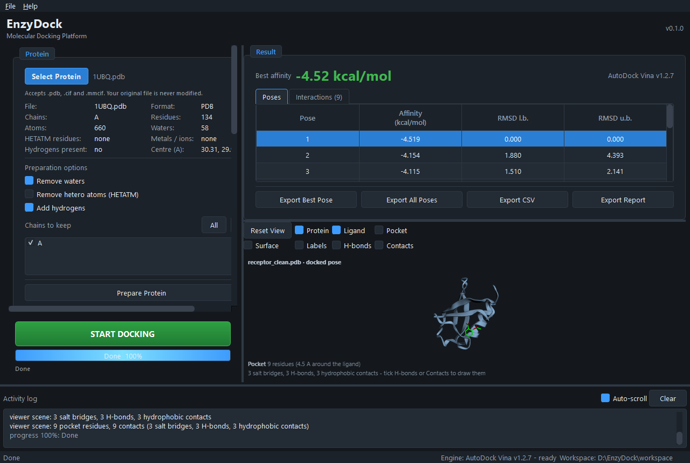
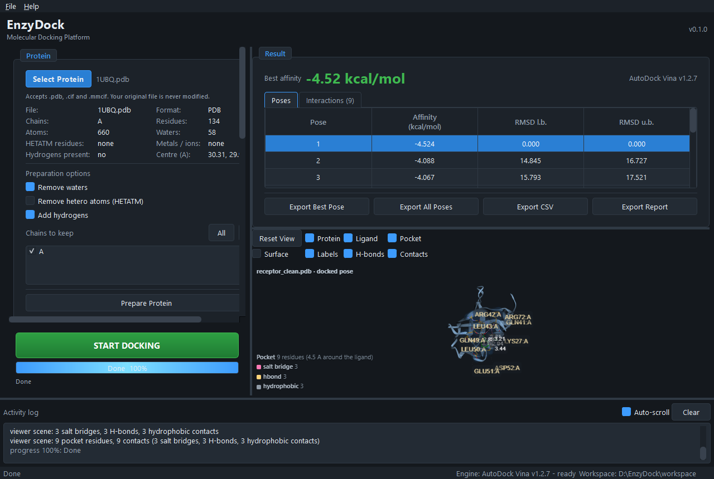
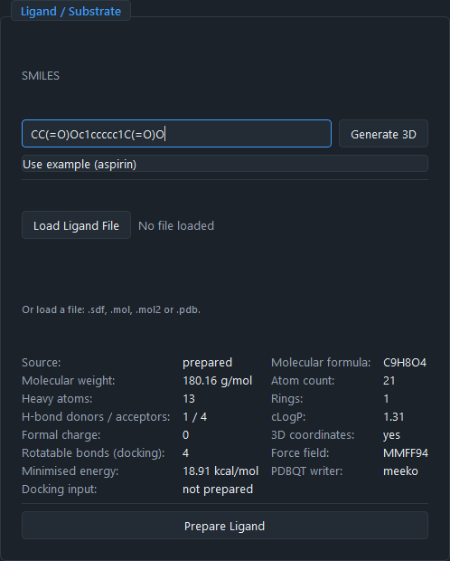
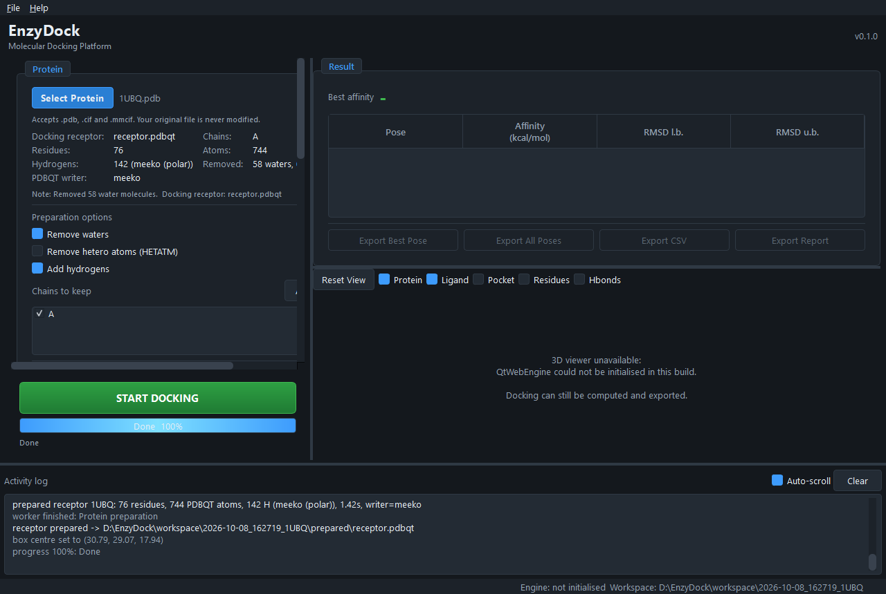
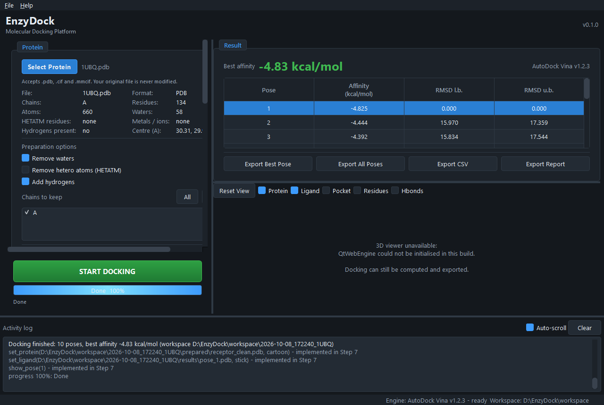

# EnzyDock


-lightgrey.svg)


**Molecular Docking Platform for Enzyme Engineering** — a desktop GUI for  
Windows and macOS (Apple Silicon / Intel) that turns *protein + substrate*  
into *binding affinity + 3D poses* without touching a command line.

```
Protein + Ligand  ->  START DOCKING  ->  AutoDock Vina  ->  Affinity  ->  3D Pose
```

Built for bench scientists: paste a SMILES string or drop in a `.pdb`, press  
**START DOCKING**, and get the affinity, the pose files, a report and an  
interactive 3D view of the binding site. AutoDock Vina ships **inside** the  
application, so nothing else has to be installed.

<table>  
  <tr>  
    <td colspan="2" align="center">  
        
    </td>  
  </tr>  
  <tr>  
    <td align="center" width="50%">  
        
        
<em>Pocket, residue labels, H-bonds</em>  
    </td>  
    <td align="center" width="50%">  
        
        
<em>Ligand preparation from SMILES</em>  
    </td>  
  </tr>  
  <tr>  
    <td align="center" width="50%">  
        
        
<em>Receptor preparation</em>  
    </td>  
    <td align="center" width="50%">  
        
        
<em>Live docking progress</em>  
    </td>  
  </tr>  
</table>

| Layer         | Technology                                                                                             |
| ------------- | ------------------------------------------------------------------------------------------------------ |
| GUI           | PySide6 (Qt 6)                                                                                         |
| Chemistry     | RDKit                                                                                                  |
| PDBQT writing | meeko (fallback: OpenBabel, behind an adapter interface)                                               |
| Docking       | AutoDock Vina (adapter behind an abstract `DockingEngine`)                                             |
| 3D viewer     | 3Dmol.js embedded through `QtWebEngine`                                                                |
| Interactions  | H-bonds, salt bridges, halogen bonds, pi-stacking, hydrophobic (geometric screens, computed in Python) |
| Packaging     | PyInstaller -> `EnzyDock.exe` (Windows) / `EnzyDock.app` (macOS)                                       |

---

## Current status: Steps 1-11 (complete)

| Step | Scope                                                                | State  |
| ---- | -------------------------------------------------------------------- | ------ |
| 1    | Project skeleton, environment, `pyproject.toml`, `requirements.txt`  | ✅ done |
| 2    | PySide6 GUI skeleton with the four functional areas                  | ✅ done |
| 3    | Ligand preparation (3D embedding, optimisation, PDBQT)               | ✅ done |
| 4    | Protein preparation (clean, protonate, PDBQT)                        | ✅ done |
| 5    | AutoDock Vina runner on a worker thread                              | ✅ done |
| 6    | Result parser (affinity, RMSD, per-pose files, CSV)                  | ✅ done |
| 7    | 3Dmol.js viewer (cartoon / sticks / pocket / surface / interactions) | ✅ done |
| 8    | Export (poses, CSV, report)                                          | ✅ done |
| 9    | End-to-end tests (real Vina, real GUI)                               | ✅ done |
| 10   | PyInstaller Windows EXE + bundle verification                        | ✅ done |
| 11   | macOS port: platform layer, Apple Silicon Vina, `.app` packaging     | ✅ done |

Features that belong to later versions (automatic pocket detection, batch  
mutant docking, AI rescoring) say so in the UI instead of failing silently.

### What Step 3 actually does

`Generate 3D` and `Prepare Ligand` now run the real pipeline on a worker  
thread (the GUI stays responsive and the progress bar reports each stage):

```text
SMILES / .sdf / .mol / .mol2 / .pdb
   -> pick the largest fragment if the file is a salt (optional)
   -> add hydrogens
   -> embed 3D coordinates (ETKDGv3, automatic retry from random coords)
   -> minimise (MMFF94, automatic fallback to UFF)
   -> AutoDock atom typing + Gasteiger charges  [meeko]
   -> workspace/<timestamp>/prepared/ligand.pdbqt
```

Design notes:

- **The converter is an adapter.** `app/chemistry/conversion.py` defines  
  `PDBQTConverter`; `MeekoConverter` is preferred, `OpenBabelConverter`  
  (Python module *or* `obabel` CLI) is the fallback. Nothing else in the  
  codebase names a backend — `write_pdbqt()` picks the best installed one and  
  explains how to fix it when none is.
- **Input files are never modified.** Coordinates that come *with* the file  
  are kept as they are (a crystal pose should not be moved); pass  
  `PreparationOptions(optimize_input_3d=True)` to re-minimise them anyway.
- **One rotatable-bond number is shown**, and it is the torsion count from the  
  PDBQT file — i.e. what AutoDock will actually sample.

### What Step 4 actually does

`Prepare Protein` cleans the structure, resolves alternate locations, gets the  
hydrogens right and writes the docking receptor — again on a worker thread:

```text
.pdb / .cif / .mmcif
   -> read atoms (unchanged input file; PDB and mmCIF give identical results)
   -> drop waters                     (optional)
   -> drop HETATM hetero atoms        (optional; metals are not AutoDock types)
   -> keep only the selected chains   (optional)
   -> resolve alternate locations     (blank > A > first seen)
   -> add hydrogens                   (optional)
   -> workspace/<timestamp>/prepared/receptor_clean.pdb
                                  /receptor_protonated.pdb
   -> AutoDock atom typing + Gasteiger charges
   -> workspace/<timestamp>/prepared/receptor.pdbqt
```

Design notes:

- **meeko protonates the receptor itself.** Its residue templates fill in the  
  polar hydrogens AutoDock's hydrogen-bond term needs (142 `HD` atoms on  
  ubiquitin) without any external tool, and it types backbone donors (`N`) and  
  acceptors (`OA`) from the residue chemistry. That is exactly what  
  `prepare_receptor4.py` does, minus the dependency on MGLTools.
- **Hydrogens are only added by EnzyDock when the writer cannot do it.** The  
  `Protonator` adapter (`RDKitProtonator` first, `OpenBabelProtonator` second)  
  is used for the OpenBabel fallback path. `RDKitProtonator` reproduces  
  OpenBabel's hydrogen count exactly, so no external tool is required.  
  If protonation fails the receptor is still built and the user is told why.
- **Hydrogens must stay next to their residue.** meeko rejects a PDB whose  
  residues are interrupted, and RDKit writes newly added hydrogens into a dummy  
  `UNL` residue — `merge_hydrogens()` puts them back where they belong.
- **Alternate locations are resolved deterministically** (blank first, then  
  `A`, then the first one seen), so the same file always yields the same  
  receptor.
- **Nothing is hard-coded:** every step is data-driven from  
  `ReceptorOptions`, and the box centre is re-anchored on the *prepared*  
  receptor once waters and hetero atoms are gone.

### What Steps 5 + 6 actually do

`START DOCKING` runs the whole chain on a worker thread. Step 5 is the engine  
adapter, Step 6 turns the raw output into a pose table:

```text
workspace/<timestamp>/
   -> prepare receptor + ligand if they are missing (Steps 3/4)
   -> docking/config.txt      (reproducible parameter file)
   -> docking/command.txt     (the exact command line that was used)
   -> vina --receptor ... --ligand ... --center_x ... --out output.pdbqt
   -> docking/log.txt         (full stdout/stderr, streamed live)
   -> parse REMARK VINA RESULT  -> affinity + RMSD bounds
   -> results/pose_N.pdbqt    (AutoDock output)
   -> results/pose_N.pdb      (element column fixed for PyMOL/3Dmol)
   -> results/summary.csv
```

Design notes:

- **Paths go on the command line, not through `--config`.** Vina's own config  
  parser is unreliable with Windows paths that contain spaces.
- **Progress is real.** Vina flushes its `****` progress bar character by  
  character, so the reader parses it and the progress bar advances during the  
  run instead of jumping from 0 to 100. The bar length is derived from the  
  `|----|` header rather than hard-coded.
- **Cancel wins over the exit code.** `cancel()` sets a flag and terminates the  
  process; the read loop checks the flag *before* the exit code, otherwise a  
  job we killed would be reported as "failed".
- **Failures are translated.** "The ligand does not fit in the docking box -  
  move the box or enlarge it" beats a raw exit code 1.
- **Result parsing trusts `REMARK VINA RESULT`**, not the stdout table (the  
  table is only a fallback), and strips the stray `\x00` byte Vina writes into  
  its output file.
- **Engines are pluggable.** `app/docking/engines.py` is a registry; adding  
  QVina2/Smina/GNINA means writing one module and adding one import. The GUI  
  never names an engine outside of the engine combo box.

### What Step 7 actually does

The viewer is a thin shell around 3Dmol.js; all geometry is computed in Python  
where it can be unit tested:

```text
receptor_clean.pdb + pose_3.pdb + docking box
   -> pocket residues       (any atom within 4.5 A of the ligand)
   -> pocket atom subset    (PDB text -> sticks + transparent surface)
   -> residue labels        (centroid + an outward offset, plus a leader line)
   -> interactions          (H-bonds, salt bridges, halogen bonds,
                             pi-stacking, hydrophobic contacts)
   -> window.enzydockViewer.setScene(json)
```

Design notes:

- **The page is a dumb renderer.** `app/visualization/viewer.py` decides what is  
  a pocket and what is an interaction; the JavaScript only calls `addModel`,  
  `setStyle`, `addSurface`, `addCylinder` and `addLabel`. That keeps the logic  
  testable without a browser.
- **The receptor finding is fail-proof.** The viewer looks for  
  `prepared/receptor_clean.pdb`, then `receptor_protonated.pdb`, then the  
  untouched file archived in `workspace/input/`, and finally the PDBQT. If  
  nothing is found it says so in the status bar *and* in the 3D page instead of  
  showing a floating pose.
- **Before a pose exists the pocket falls back to the docking box**, so the  
  viewer is useful right after `Prepare Protein`.
- **The interaction list is a geometric screen**, and the UI says so: a pose  
  file carries no bond orders and at most the polar hydrogens, so a donor  
  angle test would be guesswork and aromaticity is approximated by ring size  
  plus planarity. Every hit is reported as *possible*. A protonation-aware,  
  angle-tested assignment is planned for V2.
- **Residue labels are pushed outwards** from the centre of the pocket and  
  connected back with a leader line; printing nine names at nine centroids a  
  few angstroms apart produced an unreadable smear.
- **3Dmol.js is vendored** (`app/resources/viewer/3Dmol.min.js`) so the viewer  
  works offline and inside the packaged EXE.
- **Toolbar = Protein / Ligand / Pocket / Surface / Labels / H-bonds /  
  Contacts**, and the status bar says what the toggle produced (e.g. "Binding  
  pocket: 9 residues (4.5 A around the ligand)").
- **The interaction table sits next to the poses.** The result panel has a  
  `Poses` and an `Interactions` tab; switching the pose re-derives both, so the  
  table and the 3D view always describe the same pose.
- **WebGL in VMs.** `--web-compat` no longer disables the GPU; it drops the  
  Chromium sandbox and allows SwiftShader, which is what actually makes the 3D  
  view render on machines without a usable GPU.


### What Step 8 actually does

Every run writes `results/report.md` on its own; the four buttons in the result  
panel hand the user the files they usually paste into a presentation or a lab  
notebook:

```text
workspace/<timestamp>/results/
   ├── pose_1.pdb ... pose_N.pdb     (element column fixed, PyMOL-ready)
   ├── pose_1.pdbqt ... pose_N.pdbqt
   ├── summary.csv                    pose, affinity, RMSD
   └── report.md                      full run report (Markdown)
```

| Button           | Produces                                                          |
| ---------------- | ----------------------------------------------------------------- |
| Export Best Pose | best pose as `.pdb`, plus `.pdbqt` next to it                     |
| Export All Poses | every pose + `summary.csv` + `report.md` into a folder you choose |
| Export CSV       | the pose table only                                               |
| Export Report    | the Markdown report only                                          |

Design notes:

- **`app/export/` is Qt free.** The GUI only asks *where* to write; the  
  exporters are plain Python, so they can be scripted and unit tested.
- **The report repeats every setting** (receptor, ligand, box centre and size,  
  exhaustiveness, seed, CPU, runtime) because a table of affinities is  
  worthless without the conditions that produced it.
- **The report names the *original* inputs** (`1UBQ.pdb`, `SMILES: CC(=O)...`)  
  by reading `workspace/input`, not the generated `receptor.pdbqt`.
- **The report ends with the interactions of the best pose** (kind, receptor  
  atom, ligand atom, distance), re-derived from `prepared/` and the pose file.  
  If those are gone the section says so instead of failing the export.
- **Markdown instead of `.docx`** — it opens anywhere and keeps  
  `python-docx` out of the packaged EXE.
- **Exports are copies.** The workspace remains the single source of truth.
- Failures raise `ExportError` with a readable `message` plus technical  
  `details`, shown through the usual "Show Technical Details" dialog.

### What Step 9 actually does

`tests/test_e2e.py` runs the *real* thing: the example ubiquitin structure,  
the real RDKit preparation, the real `vina.exe`, the real Qt window, the real  
exporters. Nothing is mocked, so a regression in the plumbing between the  
layers cannot hide behind green unit tests.

| Test                                            | Covers                                                          |
| ----------------------------------------------- | --------------------------------------------------------------- |
| `test_pipeline_produces_poses_and_a_report`     | prepare → dock → parse → `pose_*.pdb`/`summary.csv`/`report.md` |
| `test_pipeline_input_is_archived_and_untouched` | the user's file is copied, never modified                       |
| `test_mmcif_input_reaches_the_same_result`      | PDB and mmCIF give the same affinity (fixed seed)               |
| `test_exports_from_a_real_run`                  | best pose + full folder export on top of a real run             |
| `test_gui_journey_docks_and_exports`            | one click through `MainWindow`: load → dock → table → export    |
| `test_cancel_leaves_the_ui_usable`              | cancelling a live run never leaves the window stuck             |

Notes:

- **Skips itself without Vina.** The session fixture asks the engine whether  
  its binary exists; a machine without AutoDock Vina gets `6 skipped`, not a  
  red suite.
- **Deterministic.** The runs use `seed=42` (plus small `exhaustiveness`) so a  
  difference between two runs means a real bug, not Vina's randomness.
- **Marked `e2e`** — `pytest -m "not e2e"` gets the fast suite only.
- **No modal dialogs.** Export handlers are answered by a patched  
  `QFileDialog`; a cancelled run is silenced by patching `show_error`, because  
  the offscreen platform cannot run a modal box.
- Two real bugs surfaced here and were fixed: `app.export` was missing from  
  the packaging list in `pyproject.toml`, and a SMILES pasted together with a  
  name (`...\taspirin`, as in `examples/ligand/aspirin.smi`) failed to parse.

### What Step 10 actually does

`scripts/build_windows.py` wraps PyInstaller, and `scripts/verify_bundle.py`  
proves that the result really works:

```bat
.venv\Scripts\python.exe scripts\build_windows.py          :: onedir, ~600 MB
.venv\Scripts\python.exe scripts\verify_bundle.py          :: 27 checks
```

`verify_bundle.py` does not trust the build log. It checks that meeko's JSON  
templates, `scipy.spatial` and the QtWebEngine resources landed inside  
`_internal`, then runs `EnzyDock.exe --selftest --selftest-dock` — a complete  
docking run *inside the bundle* — and finally opens the window with  
`--viewer-probe` to confirm that 3Dmol.js and WebGL work in the packaged app.

**Diagnostics** (`app/selftest.py`) are shipped, not just used at build time:  
`EnzyDock.exe --selftest [--report FILE]` and *Help → Run Diagnostics* list  
every backend with PASS/FAIL and a hint (11 checks with `--selftest-dock`).  
A user who reports "docking does not work" can paste that report instead of  
describing their machine.

With `--selftest-pdb FILE --selftest-dock` the last two checks are the whole  
product chain: a real docking run, and then **Interaction analysis**, which  
builds the 3D scene from that very pose and reports the pocket and the contact  
counts. That is the code behind the result view, so a build that would show a  
ligand with no receptor fails the diagnostics instead of failing in front of  
the user.

Three packaging bugs were found and fixed while building this step — all of  
them produce an `.exe` that *starts* and only breaks later:

| Bug                             | Symptom                                                                                                 |
| ------------------------------- | ------------------------------------------------------------------------------------------------------- |
| `scipy` in `--exclude-module`   | meeko imports `scipy.spatial` at module level → receptor PDBQT writing dies mid-run                     |
| meeko's JSON data not collected | `import meeko` succeeds, `ResidueChemTemplates.create_from_defaults()` fails                            |
| `gemmi` in `--exclude-module`   | `meeko.polymer` → `chemtempgen` → `gemmi`; meeko silently unavailable, EnzyDock falls back to OpenBabel |

### What Step 11 actually does

Step 11 makes the source tree platform-neutral, so the same checkout builds on  
Windows and on macOS. No platform decision is made inline any more — every  
difference lives in `app/utils/platforms.py`:

| Concern                   | Windows                       | macOS                                                                    |
| ------------------------- | ----------------------------- | ------------------------------------------------------------------------ |
| Bundled engine            | `vina.exe`                    | `vina_mac_aarch64` (Intel keeps `vina_mac_x86_64` as a Rosetta fallback) |
| Tool search paths         | `%LOCALAPPDATA%`, `<exe dir>` | `/opt/homebrew`, `/usr/local`, `/Applications`, `Contents/Resources`     |
| File dialog filter        | `Programs (*.exe)`            | `All files (*)` — a Mach-O binary has no extension                       |
| User data                 | `%LOCALAPPDATA%\EnzyDock`     | `~/Library/Application Support/EnzyDock`                                 |
| Workspace                 | `~/Documents/EnzyDock`        | `~/Documents/EnzyDock`                                                   |
| Reveal in file manager    | `explorer /select,`           | `open -R`                                                                |
| "App will not start" hint | antivirus whitelisting        | Gatekeeper quarantine: `xattr -dr com.apple.quarantine …`                |

Three macOS-specific failure modes are handled explicitly, because all three  
look like "EnzyDock is broken" to the person who hits them:

- **The bundled Vina arrives without its `+x` bit.** ZIP files do not carry  
  POSIX permissions, and `chmod` inside a signed `.app` invalidates the  
  signature. `platforms.runnable_copy()` therefore copies the binary *out* to  
  `~/Library/Application Support/EnzyDock/bin` and chmods the copy.
- **The split-volume merge script has the same problem**, and a  
  `.command` file that is not executable opens in TextEdit instead of  
  running — so `HOW-TO-RUN-mac.txt` puts a `chmod +x` right next to it.
- **Gatekeeper refuses an ad-hoc signed app.** With no Apple Developer  
  ID the first launch needs right-click → Open (or `xattr -dr
  com.apple.quarantine EnzyDock.app`). `HOW-TO-RUN-mac.txt` says so, and so  
  does the error dialog when the engine will not start.
- **QtWebEngine needs JIT.** `packaging/enzydock.entitlements` grants  
  `allow-jit`, `allow-unsigned-executable-memory` and  
  `disable-library-validation`; without them Chromium dies silently and the 3D  
  view is simply blank.

Building the `.app` must happen **on a Mac** — PyInstaller is not a  
cross-compiler:

```sh
sh scripts/build_mac.sh                 :: venv + icon + build + verify, one shot
```

`scripts/build_macos.py` is the underlying PyInstaller wrapper  
(`--windowed --osx-bundle-identifier com.enzydock.app --noupx`, ad-hoc  
signature, entitlements, quarantine stripped); `scripts/verify_bundle.py --platform macos` runs the same 27 checks against  
`dist/EnzyDock.app/Contents/Frameworks` and the `Contents/MacOS/EnzyDock`  
launcher, including a real docking run inside the bundle.

`scripts/pack_distribution.py --platform macos` and  
`scripts/split_distribution.py --platform macos` produce the same verifiable  
archive and the same channel-sized pieces as on Windows — with a  
`merge-parts.command` written in **LF** (`Path.write_text` would emit CRLF  
when packing on Windows, and `/bin/sh` rejects that) and no tool that does not  
ship with macOS itself.

---

## Quick start (development)

```bat
REM 1. create the environment (Python 3.12 recommended on Windows)
python -m venv .venv
.venv\Scripts\python.exe -m pip install -r requirements.txt

REM 2. run the GUI
.venv\Scripts\python.exe run.py
```

or, equivalently:

```bat
.venv\Scripts\python.exe -m app.main --debug
```

On macOS / Linux the same thing with POSIX paths:

```sh
python3 -m venv .venv
.venv/bin/pip install -r requirements.txt
.venv/bin/python run.py            # or: .venv/bin/python -m app.main --debug
```

Useful switches:

| Switch            | Purpose                                                                                                                              |
| ----------------- | ------------------------------------------------------------------------------------------------------------------------------------ |
| `--debug`         | verbose console logging                                                                                                              |
| `--log-file PATH` | write the log somewhere else                                                                                                         |
| `--no-webengine`  | start without the embedded 3D viewer (diagnostics)                                                                                   |
| `--web-compat`    | viewer compatibility mode (no Chromium sandbox, software WebGL). Use it when the 3D view stays blank, e.g. in a VM or remote session |
| `--selftest`      | check every backend and exit; add `--selftest-pdb FILE --selftest-dock` for a real run                                               |
| `--report FILE`   | with `--selftest`: write the report there (the only readable output of a windowed build)                                             |


If the embedded viewer still cannot start, the viewer area explains why and  
offers **Open in system browser** — docking and export are unaffected.

### Packaging

**Windows** (must be built on Windows):

```bat
.venv\Scripts\python.exe scripts\build_windows.py              :: onedir (default)
.venv\Scripts\python.exe scripts\build_windows.py --zip        :: + transfer archive
.venv\Scripts\python.exe scripts\build_windows.py --onefile    :: single .exe
.venv\Scripts\python.exe scripts\verify_bundle.py              :: 27 bundle checks
```

`dist\EnzyDock\EnzyDock.exe` is the application; ship the whole folder (a ZIP  
or an installer). `--onedir` is the default because QtWebEngine ships ~150 MB  
of resources that a one-file build would unpack on every launch.

**macOS** (must be built on a Mac — PyInstaller cannot cross-compile):

```sh
sh scripts/build_mac.sh                       :: venv + icon + build + verify
.venv/bin/python scripts/build_macos.py       :: the PyInstaller step alone
.venv/bin/python scripts/build_macos.py --zip :: + transfer archive
```

`dist/EnzyDock.app` is the application (drag it to `/Applications`). The build  
is **ad-hoc signed** (`--codesign-identity -`) because no Apple Developer ID is  
involved, so the first launch on the receiving Mac needs right-click → Open.

#### The docking engine ships with the application

AutoDock Vina 1.2.7 is bundled in `app/resources/bin/` — `vina.exe` on  
Windows, `vina_mac_aarch64` on Apple Silicon (with `vina_mac_x86_64` kept as a  
Rosetta fallback) — so a fresh unzip can dock immediately, and the user is  
never asked to install anything. All three are redistributed **unmodified**  
from the official release under the Apache License 2.0, which allows  
commercial and non-commercial use and redistribution; the licence and the  
notices (`app/resources/licenses/`) travel with them, and  
`tests/test_bundled_engine.py` checks each digest, the licence files, the  
Mach-O/PE self-containment and that the native binary actually runs.

The builds are statically linked (nothing but system libraries in their import  
tables), so shipping them cannot recreate the "missing DLL / missing dylib"  
problem that a partially copied folder produces.

> **Why the binaries are in git.** They are ~1.2 MB each and the product promise  
> is that a fresh clone docks immediately — a download step, a release asset or  
> a `git-lfs` pointer would all break that. Build output, virtual environments  
> and docking workspaces are *not* committed; see `.gitignore`.

Search order, first hit wins: a path chosen in **File → Set Docking Engine**,  
`ENZYDOCK_VINA`, the bundled copy, next to the application binary,  
homebrew / `/usr/local` / `/Applications` (macOS), then `PATH`. **File → Use  
the Bundled Docking Engine** clears the custom path. *Help → Run Diagnostics*  
reports which engine was found and where.

### Sending a build to somebody else

The Windows bundle is 611 MB spread over 540 files, and copying that much  
through a chat client or a USB stick loses files more often than one would  
expect. The symptom is always the same and always misread:

```
Failed to load Python DLL '...\_internal\python312.dll'.
LoadLibrary: The specified module could not be found.
```

That is Windows error 126: `python312.dll` is there, one of *its* dependencies  
is not. `VCRUNTIME140.dll` and `VCRUNTIME140_1.dll` are inside `_internal`  
(checked with a PE import dump), so the fix is never a download — it is a  
complete copy. `pack_distribution.py` makes that verifiable:

```bat
.venv\Scripts\python.exe scripts\pack_distribution.py
```

It adds two files to the bundle and packs it into  
`dist\EnzyDock-0.1.0-win64.zip` (one file, ~235 MB, `EnzyDock/` as the single  
top-level folder), then writes `BUNDLE-MANIFEST.txt` (file count, byte count,  
SHA256 of the files a broken copy is caught by) and a `.zip.sha256` sidecar.

Both helper files ship inside the bundle:

| File                | Purpose                                                                                                                                    |
| ------------------- | ------------------------------------------------------------------------------------------------------------------------------------------ |
| `check-install.bat` | pure batch, needs no Python: verifies the key DLLs and counts the files in `_internal` (536 in a complete build)                           |
| `HOW-TO-RUN.txt`    | Chinese checklist for the receiving user: where to extract, what the DLL error means, antivirus whitelisting, `--web-compat`, `--selftest` |

Send only the archive, and send the SHA256 with it. The receiver unzips it to a  
short path (`C:\EnzyDock`, never the WeChat received-files folder), runs  
`check-install.bat`, and reports back if anything is missing.

The macOS build gets the equivalent pair — `check-install.sh` (counts files in  
`Contents/Frameworks`, and actually runs the bundled `vina_mac_aarch64 --version`) and `HOW-TO-RUN-mac.txt` — produced by the same  
`pack_distribution.py` with `--platform macos`.

#### Sending just `EnzyDock.exe` does not work

`EnzyDock.exe` is a 13 MB launcher; everything it needs — Python, RDKit, Qt,  
the 3D components — lives next to it in `_internal` (611 MB, 536 files). Copy  
the `.exe` alone and it fails with exactly the DLL error above. There is no  
single-file build that avoids this: QtWebEngine alone is ~150 MB, so a  
`--onefile` build would unpack the whole 600 MB on every launch.

#### When 235 MB is too big for the channel

WeChat and most mail services refuse files above ~100 MB. Split the archive  
into pieces that fit, and let the receiver reassemble it with tools that exist  
on every Windows:

```bat
.venv\Scripts\python.exe scripts\split_distribution.py           :: 90 MiB pieces
.venv\Scripts\python.exe scripts\split_distribution.py --part-size 45
```

It writes `dist\parts\EnzyDock-0.1.0-win64.zip.001`, `.002`, … plus  
`merge-parts.bat` and `PARTS-MANIFEST.txt`. Send every piece **and** the  
`.bat`. The receiver puts them in one folder and double-clicks  
`merge-parts.bat`, which joins them with `copy /b` (no 7-Zip, no Python, no  
PowerShell), names any piece that is missing, and prints `[ OK ]` only when the  
SHA256 matches the archive's.

On macOS the same call with `--platform macos` emits `merge-parts.command`  
instead: it joins with `cat` and checks with `shasum -a 256`, uses no tool that  
does not ship with macOS, and is written with **LF** endings even when the  
packing machine is a Windows box (a CRLF shell script dies with *syntax error  
near unexpected token*).

### "I need the macOS client, but I only have Windows"

A macOS `.app` can only be built on a Mac, so the smallest thing that reliably  
*becomes* a working client on the receiving end is the source plus one  
command. `scripts/make_mac_source_kit.py` packs exactly that (~2.8 MB):

```bat
.venv\Scripts\python.exe scripts\make_mac_source_kit.py
```

```text
EnzyDock-mac-build-kit-<version>/
├── 先看我-READ-ME-FIRST.txt        what this is, what to double-click
├── 双击我构建 EnzyDock.command     checks Python + Xcode, then builds
├── BUILD-KIT-MANIFEST.txt          file count + SHA256 of the kit
└── EnzyDock/                       the source tree (no venv, no other OS's binaries)
```

The `.command` is written with mode **0755** inside the archive — without it  
Finder opens the file in TextEdit instead of running it — and the note tells  
the receiver how to restore that bit if their unzip tool drops it.

### Tests

```bat
.venv\Scripts\python.exe -m pytest -q
```

The GUI tests run on Qt's `offscreen` platform and create a real  
`QApplication`, so they never pop up a window.

End-to-end tests (Step 9) run the real `vina.exe` and take about 20 seconds:

```bat
.venv\Scripts\python.exe -m pytest -q -m e2e          @REM only the e2e suite
.venv\Scripts\python.exe -m pytest -q -m "not e2e"    @REM everything else
```

They use the bundled engine, so they no longer depend on what happens to be  
installed on the machine that runs them (set `ENZYDOCK_VINA` to test against  
another build).

**CI** — `.github/workflows/ci.yml` runs the suite on Ubuntu, Windows and macOS  
on every push. On Linux the end-to-end tests skip themselves (no Linux Vina is  
bundled), and the rest of the suite is platform-neutral by design: every OS  
difference comes from `app/utils/platforms.py`, which the tests exercise by  
overriding `sys.platform` and `platform.machine`.

`tests/test_packaging.py` guards the four files in `packaging/`: the `.bat` must  
stay ASCII-only with CRLF line endings (a byte-order mark makes `cmd.exe` print  
an error instead of running it, and lone LF breaks its `:need` subroutine), the  
`.sh` must stay LF-only with no BOM, and the help notes must stay UTF-8 **with**  
BOM (Windows) so Notepad does not show mojibake.

The macOS port is covered by five new suites that run on any host —  
`tests/test_platforms.py` (every platform decision, simulated by overriding  
`sys.platform` and `platform.machine`), `tests/test_macho_deps.py` (the Mach-O  
parser, against hand-built images *and* the two shipped binaries),  
`tests/test_packaging_layout.py` (the `.app` / `_internal` layout  
descriptions, cross-checked against the scripts that consume them),  
`tests/test_macos_packaging.py` (packs, splits and verifies a synthetic  
`EnzyDock.app`, so the macOS half of the packaging chain is exercised even  
though the real `.app` can only be built on a Mac) and  
`tests/test_mac_source_kit.py` (the "macOS client for somebody who only has  
Windows" kit: required files, no machine leftovers, the `0755` bit on the  
`.command` entry, LF line endings, `sh -n` syntax).

That last one earned its keep immediately: it caught a doubled-up launcher  
path (`EnzyDock.app/EnzyDock.app/...`, which made the packer refuse a sound  
build) and helper scripts that were written beside the `.app` but never added  
to the archive — so the receiver would have been told to run a  
`check-install.sh` that had not been sent.

A headless end-to-end check of the ligand pipeline, driven through the real  
window and worker thread:

```bat
.venv\Scripts\python.exe scripts\smoke_start.py --web-compat --no-web ^
    --prepare-smiles "CC(=O)Oc1ccccc1C(=O)O" --screenshot build\gui_step3.png
```

The same for the receptor (Step 4) — it exits non-zero when the receptor is not  
written, so it can run in CI:

```bat
.venv\Scripts\python.exe scripts\smoke_start.py --web-compat --no-web ^
    --protein examples\protein\1UBQ.pdb --screenshot build\gui_step4.png
```

And the complete MVP chain (Steps 3-7) — prepare, dock with Vina, parse, and  
render the best pose in the embedded viewer:


```bat
.venv\Scripts\python.exe scripts\smoke_start.py --web-compat ^
    --dock examples\protein\1UBQ.pdb --exhaustiveness 8 ^
    --viewer-probe --viewer-all --screenshot build\gui_step7.png
```

Adding `--export build\export_smoke` (Step 8) also runs the exporters after the  
run and lists every file they produced.

`--viewer-probe` asks the page itself whether 3Dmol.js loaded and what it drew  
(so a blank 3D view cannot hide behind a green exit code), and `--viewer-all`  
switches on Pocket, Labels, H-bonds and Contacts first.  The probe fails the run  
when the receptor is *not* in the scene, when fewer than two models were drawn  
or when the "nothing loaded" overlay is still up — a ligand-only view used to  
be a silent failure.  It also prints the Qt geometry of the web surface next to  
the canvas size the page measured, which is how a canvas that no longer matches  
its widget gets caught.

---

## Project layout

```
EnzyDock/
├── .github/
│   └── workflows/
│       └── ci.yml               # pytest on Ubuntu + Windows + macOS
├── app/
│   ├── main.py                 # entry point (argparse, logging, excepthook)
│   ├── gui/
│   │   ├── main_window.py      # controller: wires panels <-> backend
│   │   ├── protein_panel.py    # Protein      (load, options, prepare)
│   │   ├── ligand_panel.py     # Ligand       (SMILES / file, prepare)
│   │   ├── docking_panel.py    # Binding site + parameters + START DOCKING
│   │   ├── result_panel.py     # affinity, pose table, export buttons
│   │   ├── viewer.py           # QtWebEngine host for 3Dmol.js
│   │   ├── log_widget.py       # live log panel + Qt logging bridge
│   │   ├── workers.py          # FunctionWorker: run a backend callable on QThread
│   │   ├── dialogs.py          # friendly errors with "technical details"
│   │   ├── widgets.py          # shared InfoGrid / Divider helpers
│   │   └── styles.py           # dark stylesheet
│   ├── docking/
│   │   ├── base.py             # abstract DockingEngine (Vina/QVina/Smina/GNINA)
│   │   ├── engines.py          # registry: one import line per backend
│   │   ├── docking_config.py   # BoxConfig, DockingParameters, PoseResult ...
│   │   ├── vina_runner.py      # Step 5: VinaEngine (streaming + cancel)
│   │   ├── result_parser.py    # Step 6: VINA RESULT -> poses + CSV
│   │   └── pipeline.py         # the only place that knows the step order
│   ├── chemistry/
│   │   ├── protein.py          # read-only PDB / mmCIF analysis
│   │   ├── ligand.py           # SMILES & ligand file parsing + descriptors
│   │   ├── preparation.py      # 3D embedding, optimisation, pipeline (Step 3)
│   │   ├── receptor.py         # cleaning, protonation, receptor PDBQT (Step 4)
│   │   └── conversion.py       # PDBQT writer adapters: meeko / OpenBabel
│   ├── export/
│   │   ├── report.py           # Step 8: Markdown run report (Qt free)
│   │   └── exporters.py        # Step 8: best pose / all poses / CSV / report
│   ├── visualization/
│   │   ├── viewer.py           # Step 7: pocket / labels / payload
│   │   └── interactions.py     # H-bonds, salt bridges, pi-stacking (numpy only)
│   ├── selftest.py             # Step 10: backend diagnostics (--selftest, Help menu)
│   ├── utils/
│   │   ├── platforms.py        # Step 11: the only place that knows the OS
│   │   ├── executables.py      # Vina / OpenBabel discovery (platform aware)
│   │   └── paths.py            # workspace, settings, user data dirs
│   └── resources/
│       ├── bin/                # AutoDock Vina 1.2.7, shipped (Apache 2.0)
│       │   ├── vina.exe           # Windows x64
│       │   ├── vina_mac_aarch64   # macOS Apple Silicon
│       │   └── vina_mac_x86_64    # macOS Intel (Rosetta fallback)
│       ├── licenses/           # Apache 2.0 text + third-party notices
│       ├── icons/
│       └── viewer/             # index.html + vendored 3Dmol.min.js
├── tests/                      # pytest suite (unit + GUI smoke + e2e)
├── examples/                   # sample protein & ligand files
├── docs/                       # screenshots
├── scripts/
│   ├── build_windows.py        # PyInstaller packaging, Windows (Step 10)
│   ├── build_macos.py          # PyInstaller packaging, macOS .app (Step 11)
│   ├── build_mac.sh            # one-shot macOS build (run this on a Mac)
│   ├── macho_deps.py           # Mach-O dependency dump (macOS dylib audit)
│   ├── pe_imports.py           # PE import dump (Windows DLL audit)
│   ├── packaging_layout.py     # where each OS puts the payload + what must
│   │                           # exist; consumed by pack/split/verify
│   ├── make_icons.py           # draws the app icon (.png/.icns/.ico)
│   ├── smoke_start.py          # start the GUI, screenshot it, optionally run
│   │                           # the real ligand/receptor/docking pipeline
│   ├── verify_bundle.py        # prove the packaged app really works (both OS)
│   ├── pack_distribution.py    # one verifiable ZIP + checksum manifest
│   ├── split_distribution.py   # split the ZIP into channel-sized pieces
│   └── make_mac_source_kit.py  # "here is the macOS client" for somebody who
│                               # has a Mac: source + one double-click
├── packaging/                  # files that ship to the receiver
│   ├── check-install.bat       # pure-batch completeness check (Windows)
│   ├── check-install.sh        # same for macOS; also runs the bundled Vina
│   ├── enzydock.entitlements   # JIT entitlements QtWebEngine needs on macOS
│   ├── HOW-TO-RUN.txt          # Chinese checklist, Windows receiver
│   └── HOW-TO-RUN-mac.txt      # Chinese checklist, macOS receiver
├── requirements.txt
├── requirements-dev.txt
└── pyproject.toml
```

`app/gui/widgets.py`, `app/gui/dialogs.py`, `app/gui/log_widget.py` and  
`app/gui/styles.py` are small additions to the original file list; they hold  
code that would otherwise be duplicated across the panels.

---

## Architecture rules

These are the invariants every later step must respect:

1. **The GUI never calls a docking engine directly.** It emits  
   `BoxConfig` / `DockingParameters` and receives `DockingResult`.
2. **`DockingEngine` is an abstract base class.** New backends  
   (QVina2, Smina, GNINA, AI rescoring) are added by subclassing and  
   registering — no widget changes.
3. **Long work runs off the GUI thread.** Every backend callable is executed  
   through `app.gui.workers.FunctionWorker` (a `QThread` wrapper), so the GUI  
   only ever sees `progress` / `succeeded` / `failed` signals. One job at a  
   time.
4. **User input is read-only.** Every run copies its inputs into a fresh  
   workspace under `workspace/<timestamp>/` with `input/`, `prepared/`,  
   `docking/`, `results/` and `visualization/` sub-folders.
5. **Errors are human.** Every exception surfaces as a sentence a bench  
   scientist can act on, with the traceback one click away.
6. **Paths come from `app.utils.paths`.** No hard-coded absolute paths.
7. **Only `docking/pipeline.py` knows the order of the steps.** The GUI builds  
   a `DockingRequest` and receives a `DockingResult`; it never sequences  
   preparation and docking itself.
8. **The 3D page computes nothing.** Pocket definition, residue labels and  
   every interaction are decided in `app/visualization/` (Qt free, numpy only)  
   so they can be unit tested; the JavaScript only draws what it is handed.
9. **External programs are discovered, never hard-coded.**  
   `app/utils/executables.py` resolves the Vina binary (settings, environment  
   variable, bundled `resources/bin`, next to the application, `PATH`, common  
   install folders) and explains every place it looked.
10. **No module guesses the operating system.** Every OS difference — binary  
    names, search paths, user-data locations, file-manager commands, dialog  
    filters, failure advice — comes from `app/utils/platforms.py`. A module  
    that branches on `sys.platform` itself is a bug.

---

## Roadmap beyond v0.1

- **V1.1** — automatic binding-site detection (P2Rank / fpocket) with a  
  candidate-pocket picker.
- **V1.2** — batch mutant docking (Y144P, V464L, R140K ...) with affinity  
  ranking.
- **V2** — AI rescoring: Vina score + learned score -> mutation ranking and  
  experimental recommendations.

---

## License

The EnzyDock source code is released under the [MIT License](LICENSE).

Third-party components travel with it under their own terms — the bundled  
AutoDock Vina binaries are the **unmodified** official builds under Apache 2.0,  
and 3Dmol.js is vendored under its BSD licence. Full texts, per-file SHA256  
digests and the upstream references live in  
[`app/resources/licenses/`](app/resources/licenses/). Nothing in this  
repository is a re-compilation of somebody else's work.

## Citation

EnzyDock is a front-end; the science is done by the tools it drives. If a run  
ends up in a paper, please cite the engines, not this wrapper:

| Component     | Reference                                                                                                                                                                                   |
| ------------- | ------------------------------------------------------------------------------------------------------------------------------------------------------------------------------------------- |
| AutoDock Vina | Trott O, Olson AJ. *AutoDock Vina: improving the speed and accuracy of docking with a new scoring function, efficient optimization, and multithreading.* J Comput Chem. 2010;31(2):455-461. |
| RDKit         | [rdkit.org](https://www.rdkit.org) — Landrum G. et al. *RDKit: Open-source cheminformatics.*                                                                                                |
| meeko         | Forli S. et al. *Meeko: a new software suite for preparing ligand and receptor input files for AutoDock-GPU.* (part of the AutoDock-GPU / Vina toolchain)                                   |
| 3Dmol.js      | Rego N, Koes D. *3Dmol.js: molecular visualization with WebGL.* Bioinformatics 2015;31(8):1322-1324.                                                                                        |

## Acknowledgements

The interaction screens are **geometric approximations** and say so in the UI:  
a PDBQT pose carries no bond orders, so donor angles and aromaticity cannot be  
tested properly. Treat them as a shortlist for a closer look, not as a result.

## 中文说明

**EnzyDock** 是一个给酶工程/结构生物学实验人员用的分子对接桌面软件。  
你不需要会命令行：粘贴 SMILES 或拖入蛋白文件，点「START DOCKING」，就能拿到  
结合能、构象文件、报告和可交互的 3D 结合口袋图。

- **平台**：Windows 与 macOS（Apple Silicon / Intel）源码通用；打包必须在各自  
  系统上进行（PyInstaller 不能交叉编译）。
- **对接引擎已内置** AutoDock Vina 1.2.7，不需要另外安装任何东西。
- **交互分析是几何近似**（氢键 / 盐桥 / 卤键 / π 堆积 / 疏水接触），界面上有标注，  
  请把它当作筛选，不是结论。
- 界面语言为英文（科研软件惯例），文档与说明为中文。
- 许可证：源码 MIT；内置 Vina 二进制为 Apache 2.0，详见  
  `app/resources/licenses/`。
